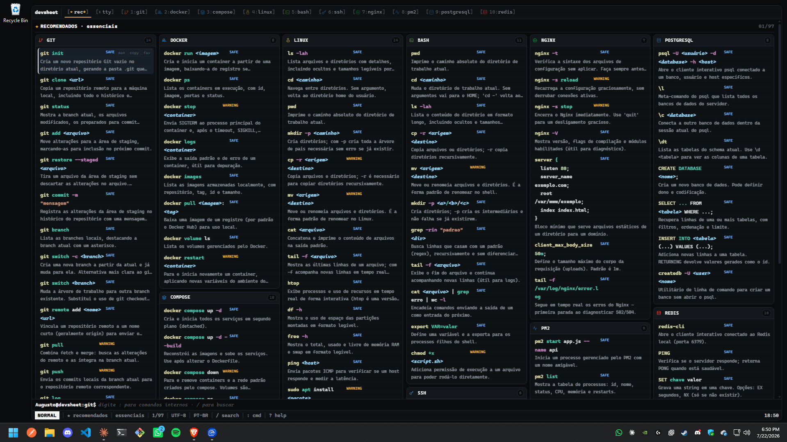
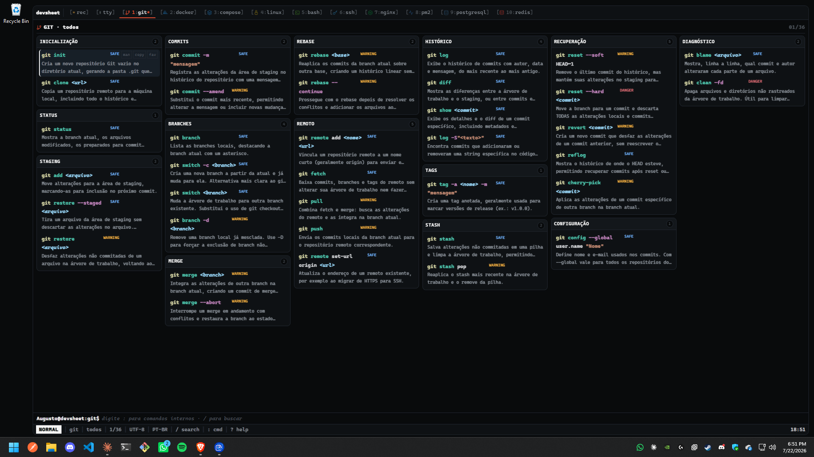
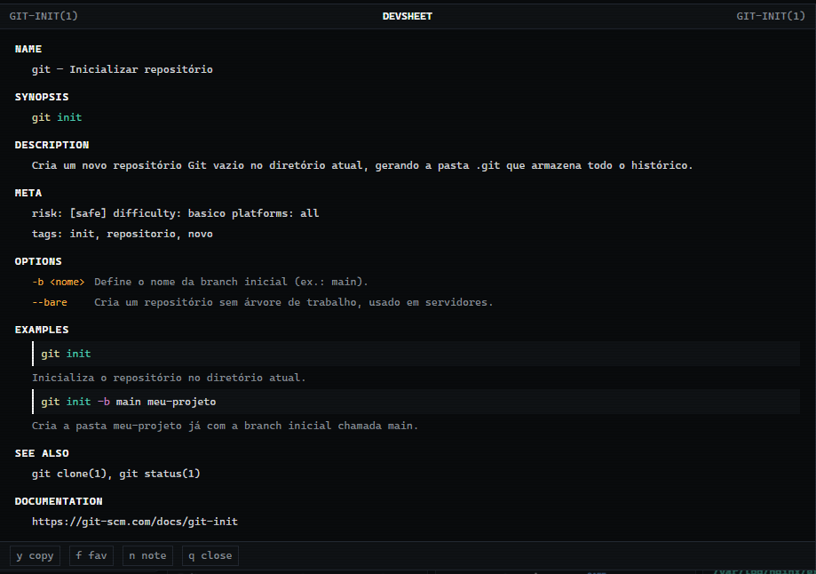
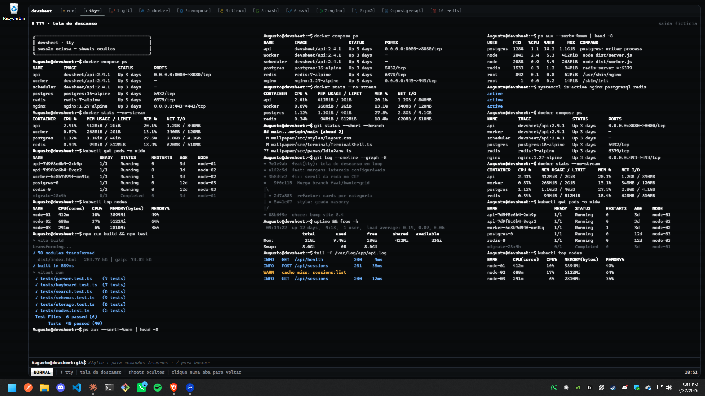
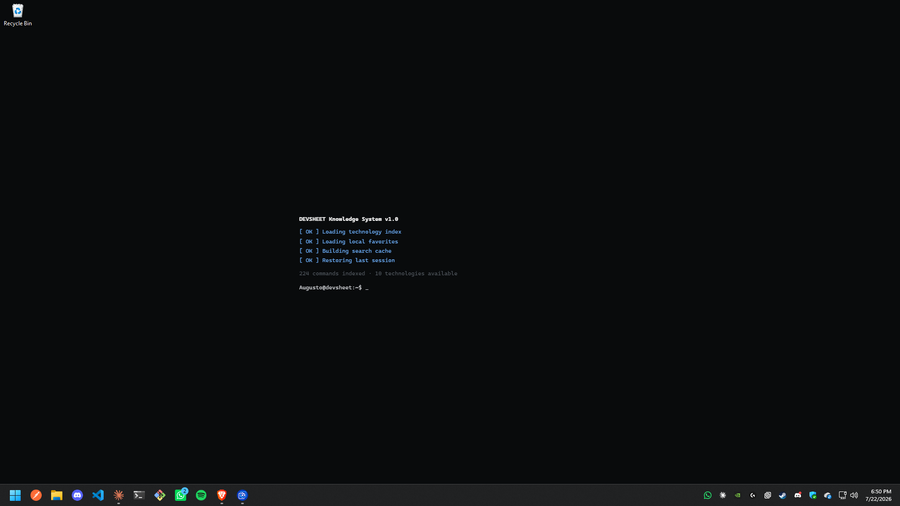
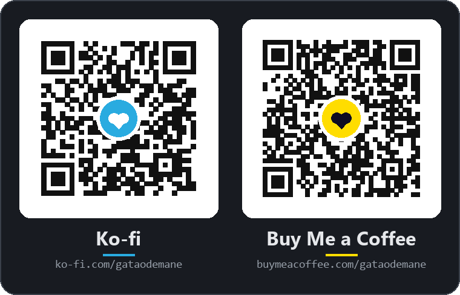

# devsheet

Um **terminal de consulta de cheat sheets** de desenvolvimento e DevOps, feito como
**Web Wallpaper** para o [Wallpaper Engine](https://www.wallpaperengine.io/). Não parece
um site nem um dashboard: parece um terminal real — abas estilo **Tmux**, statusline
estilo **Neovim**, busca estilo **FZF** e detalhes estilo **man page**.

> Ferramenta **somente de consulta**. O terminal **não executa nenhum comando do sistema** —
> apenas navega, exibe e copia texto (ver [Segurança](#segurança)).

🌎 **10 idiomas** — Português (Brasil), English, Español, Français, Deutsch, Italiano,
Русский, 简体中文, 日本語, 한국어 · ☕ [Apoie o projeto](#-apoie-o-projeto--support-the-project) ·
✍️ [Adicione um comando](https://gugupx.github.io/Dev-sheets-Wallpaper/editor/) (sem git) ·
⬇️ [Baixar](https://github.com/GuguPx/Dev-sheets-Wallpaper/releases/latest)

```
┌─ devsheet ─────────────────────────────────────────────────────────────────┐
│ [1:git*] [2:docker] [3:compose] [4:linux] [5:bash] [6:ssh] [7:nginx]  …    │
├──────────────────────────────┬──────────────────────────────────────────────┤
│ CATEGORIES        git         │ GIT · repository                    03/36    │
│ > repository                  │  01  git status                      [safe]  │
│   staging                     │      Exibe o estado atual do repositório.    │
│   commit                      │ !08  git reset --hard <commit>    [danger]   │
├──────────────────────────────┴──────────────────────────────────────────────┤
│ augusto@devsheet:git$ open docker_                                           │
├──────────────────────────────────────────────────────────────────────────────┤
│ NORMAL │ git │ repository │ 03/36 │ UTF-8 │ PT-BR │ / search │ ? help │ 18:42 │
└──────────────────────────────────────────────────────────────────────────────┘
```

## Prévia



<table>
  <tr>
    <td width="50%">
      <br />
      <sub><b>Por categoria</b> — cada tecnologia abre em abas estilo Tmux.</sub>
    </td>
    <td width="50%">
      <br />
      <sub><b>Manual</b> — <code>Enter</code> abre o comando no formato <i>man page</i>.</sub>
    </td>
  </tr>
  <tr>
    <td width="50%">
      <br />
      <sub><b>Aba <code>tty</code></b> — terminal fictício em loop / tela de descanso.</sub>
    </td>
    <td width="50%">
      <br />
      <sub><b>Boot</b> — sequência de inicialização estilo terminal.</sub>
    </td>
  </tr>
</table>

## Baixar e instalar

Para **usar** o wallpaper (sem compilar nada):

1. Baixe o `devsheet-wallpaper-v….zip` na **[página de Releases](https://github.com/GuguPx/Dev-sheets-Wallpaper/releases/latest)** e extraia — sai a
   pasta `devsheet`. Deixe-a num lugar fixo (ex.: `Documentos\devsheet`).
2. No Wallpaper Engine: **Abrir Papel de Parede → Abrir papel de parede offline (animado)**
   (*Open Wallpaper → Open offline wallpaper (animated)*) e escolha o `project.json` da pasta.
   Ou copie a pasta para `…\wallpaper_engine\projects\myprojects\` e reinicie o WE.
3. Ajuste idioma, tema e margens no painel de propriedades. O guia completo vai dentro do zip.

**Publicar uma versão nova** (mantenedor): atualize `version` no `package.json` e a seção
`## [x.y.z]` do CHANGELOG, faça commit e envie a tag — o GitHub Actions monta o `.zip` e
publica o Release sozinho:

```bash
git tag v1.1.0
git push origin v1.1.0
```

Para gerar o `.zip` localmente: `npm run package` (sai em `release/`).

## Requisitos

- Node.js **18+**
- Wallpaper Engine (para usar como papel de parede) — opcional; roda em qualquer navegador.

## Começando

```bash
npm install        # instala dependências (uma vez)
npm run dev        # abre o dev server (http://localhost:5173)
```

Abra a URL no navegador. Tudo funciona **offline**, sem back-end.

## Scripts

| Comando | O que faz |
| --- | --- |
| `npm run dev` | Dev server (Vite) com HMR. |
| `npm run build` | Typecheck + build **single-file** em `dist/index.html`. |
| `npm run package` | Build + `.zip` para distribuir fora da Workshop em `release/` (e notas do Release). |
| `npm run build:wallpaper` | Build + monta o pacote do Wallpaper Engine em `dist/`. |
| `npm test` | Testes (Vitest). |
| `npm run typecheck` | Checagem de tipos (sem emitir). |
| `npm run validate:content` | Valida todos os JSONs de conteúdo com Zod. |
| `npm run new` | Assistente: cria um comando (`new:cmd`) ou uma sheet nova (`new:sheet`) sem editar JSON. |
| `npm run editor` | Abre o editor web de sheets localmente (`docs/editor/`). |
| `npm run validate:i18n` | Valida as traduções de conteúdo e mostra a cobertura por idioma. |
| `npm run i18n:extract -- <pasta>` | Gera modelos de tradução (texto pt-BR) por tecnologia. |
| `npm run i18n:we` | Regera os rótulos traduzidos do painel do Wallpaper Engine (`project.json`). |
| `npm run gen:index` | Gera `search-index.json` (artefato de inspeção; o bundle não usa). |
| `npm run lint` / `npm run format` | ESLint / Prettier. |

O CI ([`.github/workflows/ci.yml`](.github/workflows/ci.yml)) roda formatação, lint, tipos,
validação de conteúdo e das traduções, testes e build a cada push e pull request.

Também há um script único: `pwsh scripts/build.ps1` (valida, testa, builda e empacota).

## Importar no Wallpaper Engine

### No seu PC

```bash
npm run build:wallpaper
```

Valida, gera `dist/` (um **único HTML** com JS, CSS e dados embutidos — nada é baixado em
runtime) e **copia sozinho** `index.html`, `project.json` e `preview.jpg` para
`Steam/steamapps/common/wallpaper_engine/projects/myprojects/Cheat-sheet/`. Se o seu Steam
estiver em outro lugar, defina a pasta com a variável `WE_OUT`.

1. Abra o Wallpaper Engine → o **devsheet** aparece na aba **Instalados** (se não aparecer,
   reinicie o WE ou use **Abrir Papel de Parede** e escolha o `project.json` da pasta).
2. Selecione e ajuste as propriedades à direita (idioma, tema, CRT, margens…).
3. A cada mudança no código, rode `npm run build:wallpaper` de novo e reaplique o wallpaper.

O thumbnail vem de `wallpaper/preview.jpg`.

### Publicar ou atualizar na Steam Workshop (Oficina)

1. No Wallpaper Engine, clique em **Editor de Papel de Parede** (*Wallpaper Editor*) e, no
   editor, **Arquivo → Abrir** (*File → Open*) → `myprojects/Cheat-sheet/project.json`.
2. **Arquivo → Compartilhar papel de parede na Oficina** (*File → Share Wallpaper on
   Workshop*): revise título, descrição, tags, visibilidade e o preview, aceite o acordo da
   Oficina Steam se ele aparecer e publique.
3. Para **atualizar** depois: `npm run build:wallpaper`, reabra no editor e publique de novo
   — o WE grava o `workshopid` no `project.json` da pasta e o script **preserva** esse id,
   então a publicação atualiza o mesmo item em vez de criar outro. Dica: copie o
   `workshopid` também para `wallpaper/project.json` e faça commit, para não perdê-lo se
   trocar de PC.

## Uso

- **Teclado** (completo): navegue com `j/k`, troque de tecnologia com `1..9`, busque com `/`,
  abra o manual com `Enter`, copie com `y`, favorite com `f`. Veja [KEYBINDINGS.md](KEYBINDINGS.md).
- **Mouse** (fallback): tudo é clicável — abas, categorias, comandos e os botões
  `man`/`copy`/`fav` de cada linha. Importante no Wallpaper Engine (ver abaixo).
- **Linha de comando interna** (`:`): `open docker`, `search rebase`, `theme ice`,
  `lang en`, `favorites`, `history`, `about`, `support`, `contribute`… (whitelist; nunca
  toca no sistema).

### Aba `tty` — esconder os sheets

A aba **`▮ tty`** (tecla `0`, ao lado de `★ rec`) troca os cheat sheets por uma sessão de
terminal fictícia rodando em loop — útil para compartilhar a tela sem expor o conteúdo, ou
só como tela de descanso. São 8 cenas (`docker compose ps`, `tail -f`, `kubectl`, build,
disco/rede, processos…) em ordem sorteada a cada volta, e a tela vai enchendo e rolando em
vez de limpar entre elas. Em monitores largos ela se divide em até **3 colunas
independentes**, cada uma com sua própria sessão, para ocupar a tela toda. A saída é
inventada: nada ali lê a máquina nem executa comandos.

Ela também **abre sozinha após alguns minutos sem interação** (padrão 5 min; ajuste em
Settings → *Tela de descanso após*, ou `0` para desligar). Nesse caso qualquer movimento de
mouse ou tecla acorda e devolve exatamente a aba/categoria que estava aberta. Já quando
você escolhe a aba `tty` na mão, ela fica até você clicar em outra — mexer o mouse não tira.
A statusline diz qual dos dois casos está valendo.

Com **movimento reduzido** ligado, ela vira um quadro estático; com a janela oculta, o loop
congela como o resto da app.

### Espaço para os ícones da área de trabalho

O terminal reserva margens de segurança para não cobrir os ícones do desktop nem a barra
de tarefas: **esquerda** (padrão 160px), **direita** (0) e **base** (48px). Ajuste em
**Settings** do Wallpaper Engine (`safeLeft`, `safeRight`, `safeBottom`, 0–600px) ou, no
preview/navegador, ao vivo com `:margin left 240`, `:margin right 0`, `:margin bottom 48`
(`:margin 240` sozinho vale para a esquerda).

### ⚠️ Teclado no Wallpaper Engine

Papéis de parede web no Wallpaper Engine recebem entrada de teclado de forma **limitada e
inconsistente** (o foco costuma ficar no desktop). Por isso a interface é **100% operável
pelo mouse** como alternativa. No navegador/preview o teclado funciona plenamente.

## Temas e CRT

8 temas: **graphite, ice, mint, amber, violet, vscode, caderno, classic-green**
(alterne com `t` ou `:theme <nome>`). O tema **vscode** (VS Code Dark+) combina com o
realce de sintaxe, deixando o wallpaper com cara de editor; o **caderno** é o único claro
(fundo de papel creme, código colorido em paleta clara, linhas pautadas) — inspirado em
cheat sheets de caderno. Efeitos CRT opcionais (scanlines, flicker, glow,
ruído, vinheta, aberração cromática, curvatura) com nível `off/low/balanced/high` — sutis
por padrão e desligáveis.

## Idiomas

A interface **e** todo o conteúdo (títulos, descrições, exemplos, opções, avisos e
categorias dos 224 comandos) estão traduzidos para **10 idiomas**:

| Código | Idioma | Código | Idioma |
| --- | --- | --- | --- |
| `pt-BR` | Português (Brasil) — fonte | `it` | Italiano |
| `en` | English | `ru` | Русский |
| `es` | Español | `zh-CN` | 简体中文 |
| `fr` | Français | `ja` | 日本語 |
| `de` | Deutsch | `ko` | 한국어 |

- **No Wallpaper Engine:** propriedade **Idioma** (seletor) no painel *Customize*. O padrão
  é **Automático**, que segue o idioma do sistema (fallback: inglês). Os próprios rótulos do
  painel de propriedades também são traduzidos — o WE usa o idioma escolhido na aba *Geral*
  das configurações dele.
- **No navegador/preview:** `:lang ja`, `:lang pt-BR`, `:lang auto` (`:lang` sozinho lista
  os códigos). A troca é instantânea, sem recarregar.
- Comandos, flags, ids, risco e chaves de categoria **não mudam** com o idioma — favoritos,
  notas e histórico continuam valendo. A busca indexa o texto no idioma ativo e entende
  qualquer alfabeto (cirílico, CJK, hangul).
- Algo faltando numa tradução cai no pt-BR, campo a campo. Para corrigir ou adicionar um
  idioma, veja [CONTENT_GUIDE.md](CONTENT_GUIDE.md#traduções).

## Conteúdo

Atualmente **10 tecnologias / 224 comandos**: git, docker, docker-compose, linux, bash,
ssh, nginx, pm2, postgresql, redis. Cada tecnologia é um JSON em
`wallpaper/src/data/technologies/`, validado por Zod. Para adicionar/expandir, veja
[CONTENT_GUIDE.md](CONTENT_GUIDE.md). Comandos são baseados na documentação oficial.

## Estrutura

Veja [ARCHITECTURE.md](ARCHITECTURE.md) para detalhes. Resumo:

```
devsheet-wallpaper/
├── wallpaper/            # o app (Vite root)
│   ├── index.html · project.json · vite.config.ts · tsconfig.json
│   └── src/
│       ├── terminal/     # shell, modos, teclado, parser, boot
│       ├── panes/        # abas, categorias, comandos, manual, busca, ajuda, statusline…
│       ├── services/     # conteúdo, busca, storage, clipboard, wallpaper engine
│       ├── stores/       # settings, app, favorites, history, notes
│       ├── i18n/         # t(), idiomas suportados, catálogos da interface (locales/*.ts)
│       ├── config/       # links de apoio (support.ts)
│       ├── data/         # technologies/*.json (sheets) · entries/<tech>/*.json (comandos
│       │                 #   avulsos) · i18n/<idioma>/*.json (traduções) · merge.ts
│       ├── schemas/ · types/ · utils/ · styles/
├── scripts/             # validate-content, i18n-content, we-localization, build.ps1, copy-to-wallpaper…
├── docs/editor/         # editor web de sheets (GitHub Pages)
├── tests/               # parser, keyboard, search, storage, schemas, modes, i18n, contribution
└── README · ARCHITECTURE · CONTENT_GUIDE · KEYBINDINGS · CHANGELOG
```

> **Nota de estrutura:** por decisão de DX, há **um único `package.json`/`node_modules`**
> na raiz (o `wallpaper/package.json` é apenas um marcador). Um segundo tree de
> dependências seria redundante para um wallpaper.

## ☕ Apoie o projeto · Support the project

Oi! Sou o **Augusto**, um desenvolvedor brasileiro que mora no **interior da Bahia**. O
devsheet é gratuito, open source e feito no meu tempo livre.

Aqui o real (BRL) vale bem menos que o dólar — **US$ 1 dá cerca de R$ 5** —, então qualquer
ajuda, por menor que seja, faz muita diferença e me fortalece a produzir mais wallpapers
incríveis como este. Muito obrigado! 💛

> *Hi! I'm Augusto, a Brazilian developer living in the countryside of Bahia. devsheet is
> free and made in my spare time. Here the Brazilian real is worth far less than the
> dollar — **US$ 1 is about R$ 5** — so any help, however small, makes a real difference
> and gives me the strength to make more amazing wallpapers like this one. Thank you!*

<!-- Links de apoio: mantenha em sincronia com wallpaper/src/config/support.ts, .github/FUNDING.yml e scripts/we-localization.mjs -->
<a href="https://ko-fi.com/gataodemane"></a>

[](https://buymeacoffee.com/gataodemane)
[](https://ko-fi.com/gataodemane)

Os mesmos links e QR codes aparecem no fim do painel de propriedades do Wallpaper Engine.
Dentro do wallpaper, digite **`:support`** (ou `:apoiar`, `:donate`) para ver esta mensagem
no seu idioma e copiar o link com um clique. Também ajuda muito: deixar uma ⭐ no repositório
e avaliar/favoritar o wallpaper na Steam Workshop.

## Contribuindo

Contribuições são bem-vindas — sobretudo **conteúdo**: novos comandos, dicas e sheets.

### ✍️ Adicionar um comando ou uma sheet (3 jeitos)

| Jeito | Para quem | Como |
| --- | --- | --- |
| **[Editor web](https://gugupx.github.io/Dev-sheets-Wallpaper/editor/)** | Qualquer pessoa — **sem git, sem JSON** | Preencha o formulário → **Enviar pelo GitHub**. O GitHub abre o arquivo pronto e cria o Pull Request para você. |
| **`npm run new`** | Quem clonou o repositório | Assistente no terminal: pergunta campo a campo, sugere id e risco, valida e grava o arquivo. |
| **JSON à mão** | Quem prefere editar direto | Veja o [guia de conteúdo](CONTENT_GUIDE.md). |

Cada comando novo vira **um arquivo** em `wallpaper/src/data/entries/<tecnologia>/<id>.json`
(uma sheet nova vira `technologies/<id>.json`) — então contribuições de pessoas diferentes
nunca conflitam. O CI valida tudo; a gente revisa, traduz para os outros 9 idiomas e publica.
Dentro do wallpaper, `:contribute` mostra esses links.

Veja também o **[guia de contribuição](CONTRIBUTING.md)** (ambiente e fluxo de PR) e o
**[código de conduta](CODE_OF_CONDUCT.md)**. Use as [issues](../../issues/new/choose) para
relatar bugs ou sugerir ideias.

## Segurança

O terminal é **apenas visual**. Ele **não** implementa: execução de comandos, shell,
PowerShell, acesso a arquivos, processos, rede, credenciais ou tokens. A linha de comando
aceita **somente** uma whitelist interna (`src/terminal/CommandParser.ts`), sem `eval`.
A cópia de comandos destrutivos exige **dupla confirmação** e ainda assim apenas copia o
texto — nunca executa.

## Licença

MIT — ver [LICENSE](LICENSE).
